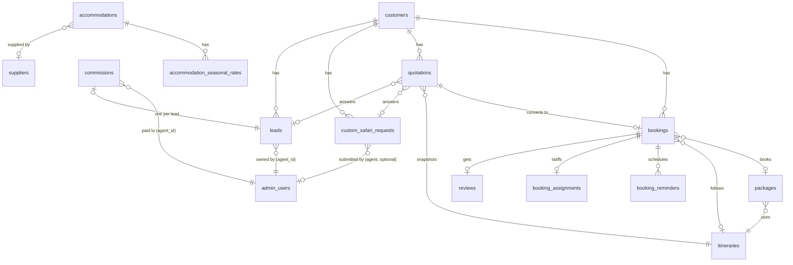

# Database Design

**Status:** Active
**Owner:** Project Team
**Version:** 1.1.0
**Last Updated:** 2026-10-19

## Purpose

The real, current schema — generated by introspecting the live database
(`SHOW TABLES` / `SHOW COLUMNS`), not by hand from memory. 31 tables plus
1 view. For the migration mechanics see §7; for how ownership is derived
(several tables below have no owner column) see
[SECURITY_ARCHITECTURE.md](SECURITY_ARCHITECTURE.md#ownership-model).

---

## 1. Entity overview

## 2. Core transactional tables

### `customers` — the unified identity

Before this table existed, the same guest's name/email/phone was copied
independently into `bookings`, `quotations`, `leads`, and
`custom_safari_requests` with no shared record. `email` (lowercased,
trimmed) is the dedup key; `App\Models\Customer::findOrCreateByEmail()` is
called everywhere a new record in those four tables is created — it fills
a missing `phone`/`country` on the existing row but never overwrites a
value already set.

| Column | Type | Notes |
|---|---|---|
| `id` | int PK | |
| `full_name`, `phone`, `country` | varchar | best-known value across every touchpoint |
| `email` | varchar(200) UNIQUE | dedup key |
| `first_seen_at` | timestamp | first contact across any channel |
| `updated_at` | timestamp | |

### `bookings` — confirmed bookings, the source of truth for revenue

| Column | Type | Notes |
|---|---|---|
| `booking_ref` | varchar(20) UNIQUE | `SZV` + `bin2hex(random_bytes(5))` — cryptographically random, not sequential |
| `tracking_password_hash` | varchar(255), nullable | bcrypt hash of the one-time Track Booking password issued at creation by `App\Services\BookingTracking::issue()` on all three booking-creation paths (`api/book.php`, `agent-portal/leads.php`, `api/convert_quotation.php`); the plaintext exists only for the one request that creates it, then is emailed and discarded — see [SECURITY_ARCHITECTURE.md](SECURITY_ARCHITECTURE.md) |
| `quotation_id`, `customer_id`, `package_id`, `itinerary_id` | int, nullable FKs | a booking can exist with none of these set (walk-in / phone booking) |
| `total_amount` | decimal(10,2) | **authoritative, frozen at booking time** — PDFs re-derive VAT from this, never recompute a different grand total from current rates |
| `deposit_amount` | decimal(10,2) | the *suggested* deposit figure computed at booking/quote time — display-only once a real payment exists, see `amount_paid` below |
| `amount_paid` | decimal(10,2), default 0.00 | **the real, cumulative amount actually received** — entered by hand when an admin marks a booking Deposit Paid (there's no bank integration to verify it automatically; `admin/bookings.php` prompts for it via `promptDialog()`), auto-set to `total_amount` on Fully Paid, or accumulated by `api/record_payment.php` for PayPal payments. This is what `api/quotation_pdf.php`, `api/booking_pdf.php` and Track Booking actually display as "Amount Paid" / "Balance Due" — `deposit_amount` is never trusted for that once a real payment is on file |
| `payment_status` | enum | `pending` / `deposit_paid` / `fully_paid` / `cancelled` — the single flag `api/quotation_pdf.php` and `api/booking_pdf.php` read fresh from the DB on every view to self-determine their document state (Quotation / partial Invoice / full Invoice); no query flag can override it |
| `paypal_order_id`, `payment_method`, `payment_notes` | | |
| `confirmation_email_sent` | tinyint(1) | set once `booking_confirmation` is successfully queued |

### `quotations` — pre-booking cost proposals

By far the widest table (50+ columns) because it snapshots everything
needed to regenerate its own PDF without depending on catalog data that
might change later (`itinerary`, `includes`, `excludes` are each a frozen
JSON copy, not just an `itinerary_id` reference).

| Column | Type | Notes |
|---|---|---|
| `quote_ref` | varchar(20) UNIQUE | e.g. `SZV-Q9DE50A6B` |
| `created_by` | int, FK → `admin_users` | **this is how agent ownership of a quotation is derived** — no separate owner column |
| `lead_id`, `custom_request_id`, `booking_id` | nullable FKs | traceability back to how this quotation originated and what it became |
| `line_items` | json | the frozen cost breakdown — every PDF/email recomputes totals from this array, never from the summary columns below, so a quotation's figures can't silently drift. A `category: "service_fee"` entry is the Service Charge — split into separate "Service Charge (Adults)" and "Service Charge (Children)" lines (each at the booked package's own `cost_breakdown.service_charge_adult`/`service_charge_child` rate, see `packages` below) rather than one combined line at a single rate for everyone; infants are never charged, see `ItineraryQuoteBuilder::build()` |
| `subtotal`, `service_charge`, `vat`, `grand_total`, `per_person`, `deposit_amount`, `balance_due` | decimal | summary snapshot columns — kept for list/report display; `api/quotation_pdf.php` itself always recalculates these fresh from `line_items` + `discount_pct` rather than trusting them, so they can drift from the PDF if something upstream changes them without a matching line-item update |
| `markup_pct`, `discount_pct`, `discount_amount` | decimal | `markup_pct` is captured here but **not currently applied** by `api/quotation_pdf.php`'s own total recompute — a known gap, see [SYSTEM_ARCHITECTURE.md](SYSTEM_ARCHITECTURE.md#8-known-architectural-gaps) |
| `status` | enum | `draft` / `sent` / `viewed` / `negotiating` / `accepted` / `declined` / `expired` / `converted` |
| `public_token` | varchar(64) UNIQUE | the client-facing view link's only credential — `api/quote_view.php` accepts no other identifier |
| `view_count`, `first_viewed_at`, `last_viewed_at` | | written by `api/quote_view.php` on every token-authenticated view; also where `status` auto-advances `sent` → `viewed` (never backward) |

### `leads` — the agent sales pipeline

| Column | Type | Notes |
|---|---|---|
| `agent_id` | int, FK → `admin_users` | **the actual ownership column for this table** (unlike bookings/quotations, leads do have one) |
| `pipeline_stage` | enum | `lead` / `qualified` / `quoted` / `negotiation` / `booked` / `travelled` / `completed` / `lost` — advanced only forward by `PipelineSync`, never resurrects `lost`/`closed` |
| `commission_rate`, `commission_amount`, `commission_status` | | an agent cannot set `commission_rate` themselves — enforced server-side, not just hidden in the UI |
| `booking_ref` | varchar(50) | populated once this lead converts |
| `score` | int | lead scoring, currently unused by any automated logic |

### `commissions` — audit trail of every commission ever created

| Column | Type | Notes |
|---|---|---|
| `lead_id` | int UNIQUE | the unique constraint is deliberate — it's what makes `PipelineSync`'s `ON DUPLICATE KEY UPDATE` upsert safe (one commission per lead, not one row per status change) |
| `agent_id` | int, FK → `admin_users` | |
| `status` | enum | `pending` / `approved` / `paid` / `cancelled` |
| `approved_by` | int, FK → `admin_users` | |

### `custom_safari_requests` — bespoke itinerary enquiries

| Column | Type | Notes |
|---|---|---|
| `submitted_by_agent_id` | int, nullable FK → `admin_users` | the **one deliberate exception** to this table having no owner column — see below |

Ownership is still mostly derived, never stored: an agent's visibility
into a request is normally through a linked `quotations.created_by`, via
`OwnershipScope::ownsCustomRequest()`. The one case that can't be derived
that way is a request an agent submits directly from the agent portal's
"New Client → Custom Request" flow — at creation time there's no
quotation yet for ownership to derive from, so `submitted_by_agent_id` is
stamped instead. It keeps the submitting agent's visibility even after an
admin later builds the quotation under their own `created_by`. A request
submitted via the public site (or by staff/admin) leaves this `NULL`.

## 3. Catalog tables

| Table | Purpose |
|---|---|
| `packages` | the sellable products; `itinerary_id` → `itineraries`, plus `package_tier`, `operational_cost`/`selling_price`/`profit_margin_percent` for the profitability dashboard. `cost_breakdown` (json) holds `service_charge_adult`/`service_charge_child` — the per-person Service Charge rate this package actually charges, split by traveler type (infants are always free); a package saved before this split only has the old flat `service_charge_pax`, read as both rates' fallback wherever it's consumed |
| `itineraries` | day-by-day templates; `days` is a JSON array of `{day, title, location, accommodation, vehicle, parks, activities, meals}` — this is what `ItineraryQuoteBuilder` actually prices against |
| `accommodations` / `accommodation_seasonal_rates` | lodge/camp catalog with per-season rate overrides |
| `vehicles` | fleet catalog — daily/fuel/driver/maintenance/insurance cost components |
| `park_fees` | per-park adult/child/resident entry fees |
| `activities` | optional paid activities |
| `seasonal_rates` | peak/shoulder/low multipliers by month |
| `suppliers` | accommodation/park-operator/activity/transport vendor contacts. `contract_filename`/`contract_original_name`/`contract_uploaded_at` hold an optional Contract PDF — stored in `storage/uploads/contracts/` (outside the web root, blocked by `.htaccess`), served only through `api/supplier_contract.php`'s own admin-auth check. Upload is real content-type sniffed (`finfo`), not trusted by filename/extension |

## 4. Operations tables

| Table | Purpose |
|---|---|
| `staff` | guides/drivers — `daily_rate`, `license_number`, `languages` |
| `booking_assignments` | which `staff_id`/`vehicle_id` is assigned to a `booking_ref` |
| `operations_calendar` view (none — computed live in `admin/operations_calendar.php`) | — |
| `incidents` | field incident log: type, severity, resolution |
| `emergency_contacts` (page only, no dedicated table — reuses `staff`/`suppliers`) | — |
| `room_availability` (page only — computed live against `accommodations`) | — |

## 5. Communication / system tables

| Table | Purpose |
|---|---|
| `email_queue` | every outbound email; `status` pending/sent/failed, `attempts` capped at 3, `attachments` as JSON, `is_plain_text` flag |
| `email_templates` | DB-backed overrides for the 14 templated email types (`template_key`, `subject`, `body_html`, `is_custom`) — see [SYSTEM_ARCHITECTURE.md §6](SYSTEM_ARCHITECTURE.md#6-email-system) |
| `booking_reminders` | the 4 (now up to 5, including `win_back`) scheduled rows per booking |
| `contact_messages` | public contact form inbox |
| `activity_log` | every mutating admin action AND every `access_denied` event — `actor_id`, `action`, `entity_type`/`entity_id`, `details` JSON |
| `analytics_events` | lightweight page-view/event tracking from the public site |
| `settings` | key/value override store (`key` VARCHAR PK, `value` TEXT) — only holds a row for a key an admin has actually changed from its default; every readable key, its default, and what reads it is defined in `config/app.php`'s `_setting()` calls (business rules, Platform Controls toggles, Security thresholds — see [SYSTEM_ARCHITECTURE.md §9](SYSTEM_ARCHITECTURE.md)), edited from Settings → General |
| `currency_rates` | display-currency conversion rates (`code` PK, `rate_to_usd`) |
| `schema_migrations` | tracks which `sql/*.sql` files have been applied — see §7 |
| `reviews` | guest reviews, `is_published` gate before showing publicly |

## 6. People tables

| Table | Purpose |
|---|---|
| `admin_users` | every admin-panel login — `role` enum (`superadmin`/`admin`/`agent`/`staff`), `commission_rate`, `target_monthly` |
| `agent_targets` | monthly target vs. actual per agent |

## 7. Migrations

Real convention: a dated file in `sql/YYYY_MM_description.sql`, applied by
stripping `--` comment lines and executing each `;`-separated statement,
then recorded with `INSERT IGNORE INTO schema_migrations (filename)`. 40
migrations have been applied this way as of this writing.

A `database/migrations/` folder existed briefly as an earlier, abandoned
approach (hand-run in phpMyAdmin, no tracking table) — it predates and was
superseded by the convention above; none of its files appear in
`schema_migrations`.

## 8. The one view

`vw_package_profitability` — `package_id`, `price_1pax`,
`operational_cost`, `selling_price`, `profit_amount`,
`profit_margin_percent`. Read by `admin/dashboard_profitability.php`
alongside a live per-category cost breakdown computed through
`ItineraryQuoteBuilder::build()` for each package.

> **Margin is measured on the VAT-exclusive price.** `price_1pax` is
> VAT-inclusive (`supplier_cost × (1 + VAT_RATE)`), so any margin
> calculation must divide out VAT first or it silently counts the 18%
> tax as profit.
