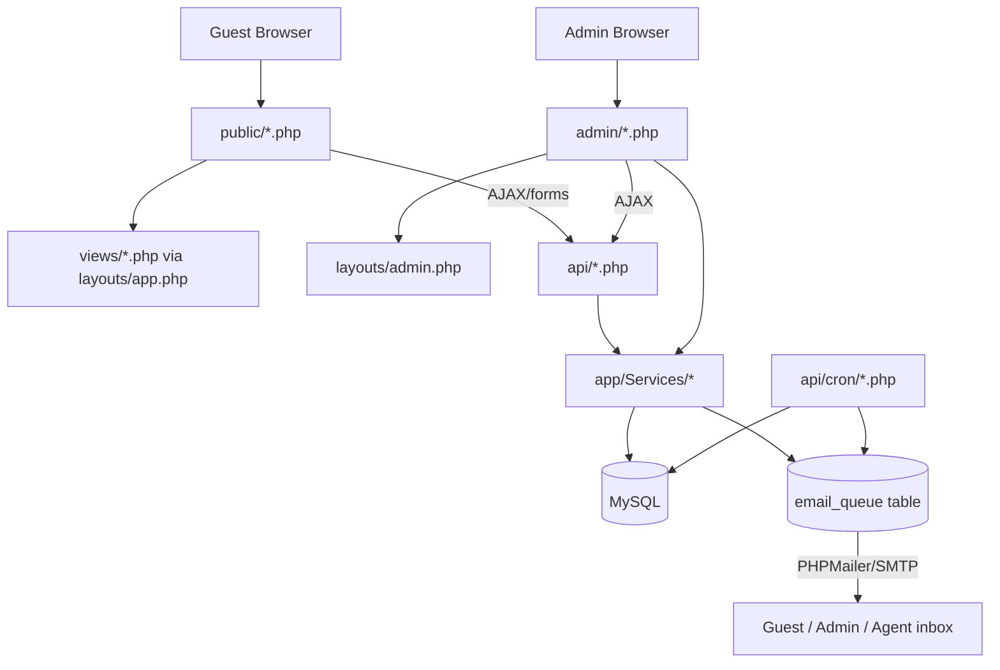

# System Architecture

**Status:** Active
**Owner:** Project Team
**Version:** 1.0.0
**Last Updated:** 2026-10-16

## Purpose

Describes how Safari Zangu Ventures is actually built — the request
lifecycle, the service layer, and how the pieces fit together. For table
structure see [DATABASE_DESIGN.md](DATABASE_DESIGN.md); for endpoints see
[API_SPECIFICATION.md](API_SPECIFICATION.md); for the access-control model
see [SECURITY_ARCHITECTURE.md](SECURITY_ARCHITECTURE.md).

---

## 1. What this is

A custom PHP 8.3 application — no framework (no Laravel/Symfony) — running
on Apache + MySQL/MariaDB, deployed to Hostinger shared hosting in
production. There is no build step, no bundler, no SPA: every page is a
server-rendered PHP script. The only Composer dependencies are
`phpmailer/phpmailer` and `dompdf/dompdf`.



## 2. Request lifecycle

Every `public/*.php` entry point follows the same shape:

```
public/about.php
  → require '../app/bootstrap.php'   (autoload, session, config, DB)
  → set $pageTitle / $pageDescription
  → ob_start(); include '../views/about.php'; $content = ob_get_clean();
  → include '../layouts/app.php'     (wraps $content in nav + footer)
```

`admin/*.php` pages follow the same pattern but through
`layouts/admin.php`, and every one calls `AuthMiddleware::requireAdmin()`
(or one of its role-specific variants) before doing anything else.

`.htaccess` rewrites `safarizanguven.com/about.php` to `public/about.php`
transparently — `/public/` never appears in a URL. It also 403s direct
HTTP access to `app/`, `config/`, `storage/`, `sql/`, and `api/cron/`.

`api/*.php` endpoints are plain request handlers — no router, no
controller base class. Each one validates input, calls into
`app/Services/` or `app/Models/` for anything non-trivial, and returns
JSON (or, for the PDF endpoints, streams HTML that `App\Services\PdfRenderer`
converts to a PDF — see §5).

## 3. Layers

| Layer | Location | Responsibility |
|---|---|---|
| Entry points | `public/`, `admin/`, `api/` | Request handling, auth checks, response shaping |
| Views | `views/` | Public-site HTML templates, included by `public/*.php` |
| Layouts | `layouts/` | Shared page shells (`app.php` public, `admin.php` admin) |
| Models | `app/Models/` | Thin DB access objects: `Database` (PDO singleton), `Booking`, `Customer`, `CustomSafariRequest`, `Package` |
| Services | `app/Services/` | Business logic — see §4 |
| Middleware | `app/Middleware/` | `AuthMiddleware`, `CsrfMiddleware`, `RateLimiter`, `Honeypot` |
| Mail | `app/Mail/` | `Mailer` (queueing) + `EmailTemplate` (rendering) |
| Helpers | `app/Helpers/` | `Formatter`, `AdminIcon`, `Env`, `ImageOptimizer`, `ItineraryDayCards`, `TripExtensions` |
| Validators | `app/Validators/` | `BookingValidator` |
| Config | `config/app.php` | All constants, loaded from `.env` |

## 4. The service layer

This is where the real logic lives — the pieces worth understanding before
changing anything pricing- or access-related:

- **`ItineraryQuoteBuilder`** — the single pricing engine. `build()` turns
  a day-by-day itinerary (accommodation, vehicle, park fees, activities,
  meals) plus pax counts into itemized line items, each tagged with a
  `category` (`accommodation`/`transport`/`park_fee`/`activity`/
  `service_fee`/`other`) used for cost-breakdown display and profitability
  reporting. `totals()` takes those line items through
  subtotal → markup → discount → VAT → deposit, reading `VAT_RATE` and
  `DEPOSIT_PERCENT` from `config/app.php` as the single source of truth —
  every PDF and the quotation builder's live JS preview derive from this
  same constant rather than hardcoding the rate.
- **`PdfRenderer`** — generates every PDF by capturing the exact HTML its
  `api/*_pdf.php` counterpart already produces for on-screen viewing (via
  an isolated-scope include with `SZV_PDF_INTERNAL_RENDER` defined, which
  skips that file's normal admin-session check only for this trusted,
  server-side call), then running it through dompdf. One implementation
  shared by every place that emails a PDF, instead of each caller
  duplicating the capture logic.
- **`OwnershipScope`** — the single place that answers "does this agent
  own this record." Bookings and `custom_safari_requests` have no owner
  column; ownership is derived by joining through `quotations.created_by`
  and `commissions.agent_id`. See
  [SECURITY_ARCHITECTURE.md](SECURITY_ARCHITECTURE.md#ownership-model).
- **`AccessGuard`** — denies a request (`denyJson`/`denyRedirect`/
  `denyPlain`) and logs the denial to `activity_log` with
  `action='access_denied'` before denying, so every blocked attempt is
  auditable.
- **`PipelineSync`** — the single place a lead or custom request's status
  auto-advances, and the single place a commission record gets created.
  Both the automatic (page-load) and manual (stage-dropdown) paths go
  through the same private `writeLeadStage()`/`createCommission()`
  methods, so there is exactly one commission-creation code path, not two
  that can drift apart.
- **`InvoiceMailer`** — sends the Invoice + Itinerary PDF pair once a
  booking's `payment_status` transitions to `fully_paid`.
- **`PayPalClient`** — verifies a PayPal order server-side (OAuth2 +
  `/v2/checkout/orders/{id}`) before any booking is marked paid; the
  client-reported amount/status is never trusted.
- **`AccommodationAvailability`**, **`BookingReminderScheduler`**,
  **`ActivityLog`** — room-availability checks, the four reminder rows
  inserted per booking, and the audit-log writer used throughout.

## 5. PDF generation

There is no single "PDF template" system — each `api/*_pdf.php` file's own
HTML/CSS *is* the document layout, both for on-screen viewing and for the
emailed attachment (`PdfRenderer` just captures that same HTML and feeds
it to dompdf). The live documents:

| File | Document |
|---|---|
| `api/quotation_pdf.php` | Quotation / Invoice (cost breakdown + totals) |
| `api/quotation_itinerary_pdf.php` | Quotation's day-by-day itinerary |
| `api/booking_pdf.php` | Booking Confirmation / Invoice |
| `api/booking_itinerary_pdf.php` | Booking's day-by-day itinerary |
| `api/voucher_pdf.php` | Travel voucher |
| `api/manifest_pdf.php` | Daily departure manifest (ops) |
| `api/track_booking_pdf.php` | Public download on the guest Track Booking page (thin wrapper around `booking_pdf.php`) |

A quotation and a booking are deliberately split into two focused PDFs
(pricing, and itinerary) rather than one long combined document, and
either one is re-labeled INVOICE once the linked booking's
`payment_status` is verified `fully_paid` server-side — the `?invoice=1`
URL flag only *requests* that view; it can't misrepresent an unpaid
booking, because the real status is always re-queried fresh.

## 6. Email system

Nothing sends synchronously during a web request.

```
Mailer::queue('template_key', $vars)
  → EmailTemplate::render('template_key', $vars)   (checks the email_templates
                                                       DB table for a saved
                                                       custom override first,
                                                       falls back to the
                                                       hardcoded tpl_* method)
  → INSERT INTO email_queue (status='pending')
  → attempts an immediate background send via api/cron/send_single_email.php
  → falls back to a synchronous send if that fails

api/cron/process_email_queue.php (cron, every few minutes)
  → the retry net: picks up anything still 'pending' or failed under 3 attempts
```

14 of the system's email types are templated this way and editable from
`admin/email_templates.php`. A few flows — `api/quotation_email.php`
(the actual "send to client" action), `api/booking_email.php` (admin's
manual resend), `api/voucher_email.php`, `InvoiceMailer`, and
`api/review_submit.php` — call `Mailer::queueRaw()` with HTML/text they
build inline instead, so editing the matching template in the admin UI
has no effect on those; they're edited directly in the PHP file.

## 7. Admin panel surface

~37 pages under `admin/`, organized into: Dashboard, Operations
(bookings, custom requests, reminders, invoices), Communications (leads,
quotations, email queue/templates, contact messages), Catalog (packages,
itineraries, activities, park fees, seasonal rates), Field Operations
(vehicles, staff, suppliers, operations calendar, room availability,
emergency contacts, incidents), People & Partners (users, customers,
agents), Analytics (6 dashboard variants: sales, operations, fleet,
profitability, customer experience, agents), Agent-specific views, Gallery,
and Settings (currency rates, activity log). Role-based visibility and
data-ownership scoping for all of this is covered in
[SECURITY_ARCHITECTURE.md](SECURITY_ARCHITECTURE.md).

## 8. Known architectural gaps

Documented honestly rather than glossed over:

- **No automated test coverage for the pricing engine itself** —
  `tests/run.php` covers pure-logic pieces (`Formatter`, `BookingValidator`,
  season detection, rate limiting) but `ItineraryQuoteBuilder::build()`
  needs a live DB connection for its rate lookups, so it's only exercised
  manually through `admin/quotation_new.php` / `api/book.php`.
- **Two parallel booking-pricing paths** — a booking converted from a
  quotation carries the quotation's own frozen `line_items`; a booking
  with no quotation gets its cost breakdown rebuilt live from current
  accommodation/park-fee rates at PDF-render time. The actual charged
  total (`bookings.total_amount`) is always the frozen, authoritative
  figure; only the itemized *display* can drift from current rates for
  the second group.
- **Superadmin and Admin are currently identical** in every permission
  check — this is a deliberate "not yet differentiated" state, not an
  oversight, documented so it isn't mistaken for a bug.
