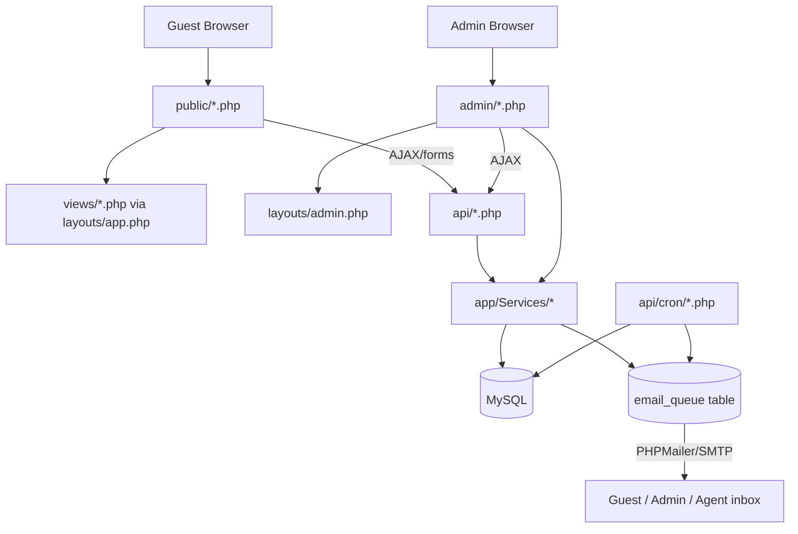

# System Architecture

**Status:** Active
**Owner:** Project Team
**Version:** 1.1.0
**Last Updated:** 2026-10-19

## Purpose

Describes how Safari Zangu Ventures is actually built — the request
lifecycle, the service layer, and how the pieces fit together. For table
structure see [DATABASE_DESIGN.md](DATABASE_DESIGN.md); for endpoints see
[API_SPECIFICATION.md](API_SPECIFICATION.md); for the access-control model
see [SECURITY_ARCHITECTURE.md](SECURITY_ARCHITECTURE.md).

---

## 1. What this is

A custom PHP 8.3 application — no framework (no Laravel/Symfony) — running
on Apache + MySQL/MariaDB, deployed to Hostinger shared hosting in
production. There is no build step, no bundler, no SPA: every page is a
server-rendered PHP script. The only Composer dependencies are
`phpmailer/phpmailer` and `dompdf/dompdf`.



## 2. Request lifecycle

Every `public/*.php` entry point follows the same shape:

```
public/about.php
  → require '../app/bootstrap.php'   (autoload, session, config, DB)
  → set $pageTitle / $pageDescription
  → ob_start(); include '../views/about.php'; $content = ob_get_clean();
  → include '../layouts/app.php'     (wraps $content in nav + footer)
```

`admin/*.php` pages follow the same pattern but through
`layouts/admin.php`, and every one calls `AuthMiddleware::requireAdmin()`
(or one of its role-specific variants) before doing anything else.

`.htaccess` rewrites `safarizanguven.com/about.php` to `public/about.php`
transparently — `/public/` never appears in a URL. It also 403s direct
HTTP access to `app/`, `config/`, `storage/`, `sql/`, and `api/cron/`.

`api/*.php` endpoints are plain request handlers — no router, no
controller base class. Each one validates input, calls into
`app/Services/` or `app/Models/` for anything non-trivial, and returns
JSON (or, for the PDF endpoints, streams HTML that `App\Services\PdfRenderer`
converts to a PDF — see §5).

## 3. Layers

| Layer | Location | Responsibility |
|---|---|---|
| Entry points | `public/`, `admin/`, `agent-portal/`, `api/` | Request handling, auth checks, response shaping |
| Views | `views/` | Public-site HTML templates, included by `public/*.php` |
| Layouts | `layouts/` | Shared page shells (`app.php` public, `admin.php` admin, `agent.php` agent portal) |
| Models | `app/Models/` | Thin DB access objects: `Database` (PDO singleton), `Booking`, `Customer`, `CustomSafariRequest`, `Package` |
| Services | `app/Services/` | Business logic — see §4 |
| Middleware | `app/Middleware/` | `AuthMiddleware`, `CsrfMiddleware`, `RateLimiter`, `Honeypot` |
| Mail | `app/Mail/` | `Mailer` (queueing) + `EmailTemplate` (rendering) |
| Helpers | `app/Helpers/` | `Formatter`, `AdminIcon`, `Env`, `ImageOptimizer`, `ItineraryDayCards`, `TripExtensions` |
| Validators | `app/Validators/` | `BookingValidator` |
| Config | `config/app.php` | All constants, loaded from `.env`, each overridable from the `settings` DB table — see §9 |

## 3a. Agent Portal — a second front door

`agent-portal/` is a standalone surface for the `agent` role, parallel to
(not nested inside) `admin/` — its own `login.php`/`logout.php`,
`index.php` dashboard, `leads.php`, `commissions.php`, `profile.php`, and
`layouts/agent.php` as its page shell (loads `admin/css/admin.css` first
so every shared component class still renders identically, then its own
`agent-portal/css/agent.css` for just the top-navbar shell admin's
sidebar layout doesn't need). A successful agent login on `admin/login.php`
itself redirects straight into `agent-portal/index.php` rather than the
admin dashboard — in practice the portal is an agent's whole experience,
though the admin-embedded agent views still work as a fallback (see
[SECURITY_ARCHITECTURE.md §1](SECURITY_ARCHITECTURE.md)).

The portal's one substantial piece of business logic is
`agent-portal/leads.php`'s "New Client" flow: an agent first picks
**Direct Booking** (of an existing package — creates a real `bookings` row
plus a linked `quotations` row stamped with their own `created_by`,
carries a `leads` row straight to `booked` through `PipelineSync` so
commission creation fires exactly as a manual admin stage-change would,
issues the Track Booking password, and emails the client) or **Custom
Request** (creates a `custom_safari_requests` row through the same
`App\Models\CustomSafariRequest` the public enquiry form uses, tagged
`submitted_by_agent_id` — see
[DATABASE_DESIGN.md](DATABASE_DESIGN.md#core-transactional-tables)).
Direct Booking is gated by the `agent_direct_booking_enabled` setting
(§9) — off, the choice card itself doesn't render, and the client is
guided to Custom Request instead.

## 4. The service layer

This is where the real logic lives — the pieces worth understanding before
changing anything pricing- or access-related:

- **`ItineraryQuoteBuilder`** — the single pricing engine. `build()` turns
  a day-by-day itinerary (accommodation, vehicle, park fees, activities,
  meals) plus pax counts into itemized line items, each tagged with a
  `category` (`accommodation`/`transport`/`park_fee`/`activity`/
  `service_fee`/`other`) used for cost-breakdown display and profitability
  reporting. The Service Charge line (`category: service_fee`) is split
  into separate Adults/Children entries, each priced from an optional
  `$serviceFeeRates` argument (`['adult' => x, 'child' => y]`) — a
  caller with a real package passes its own
  `cost_breakdown.service_charge_adult`/`service_charge_child` rates;
  without one, both default to the same flat $100/person every caller
  used before this split existed, so nothing already booked silently
  repriced. Infants are never charged — they're excluded from the
  adults/children counts entirely, not specially zeroed. `totals()` takes
  those line items through subtotal → markup → discount → VAT → deposit,
  reading `VAT_RATE` and `DEPOSIT_PERCENT` from `config/app.php` as the
  single source of truth — every PDF and the quotation builder's live JS
  preview derive from this same constant rather than hardcoding the rate.
- **`BookingTracking`** — issues and verifies the Track Booking one-time
  password (`issue()` generates + bcrypt-hashes it into
  `bookings.tracking_password_hash`; `verify()` is the one place a
  ref+password pair is checked). See
  [SECURITY_ARCHITECTURE.md §5a](SECURITY_ARCHITECTURE.md).
- **`PdfRenderer`** — generates every PDF by capturing the exact HTML its
  `api/*_pdf.php` counterpart already produces for on-screen viewing (via
  an isolated-scope include with `SZV_PDF_INTERNAL_RENDER` defined, which
  skips that file's normal admin-session check only for this trusted,
  server-side call), then running it through dompdf. One implementation
  shared by every place that emails a PDF, instead of each caller
  duplicating the capture logic.
- **`OwnershipScope`** — the single place that answers "does this agent
  own this record." Bookings and `custom_safari_requests` have no owner
  column; ownership is derived by joining through `quotations.created_by`
  and `commissions.agent_id`. See
  [SECURITY_ARCHITECTURE.md](SECURITY_ARCHITECTURE.md#ownership-model).
- **`AccessGuard`** — denies a request (`denyJson`/`denyRedirect`/
  `denyPlain`) and logs the denial to `activity_log` with
  `action='access_denied'` before denying, so every blocked attempt is
  auditable.
- **`PipelineSync`** — the single place a lead or custom request's status
  auto-advances, and the single place a commission record gets created.
  Both the automatic (page-load) and manual (stage-dropdown) paths go
  through the same private `writeLeadStage()`/`createCommission()`
  methods, so there is exactly one commission-creation code path, not two
  that can drift apart.
- **`InvoiceMailer`** — sends the Invoice + Itinerary PDF pair on a
  genuine payment transition: `sendForBooking()` once `payment_status`
  reaches `fully_paid`, `sendDepositReceipt()` once it reaches
  `deposit_paid`. Both are called from `admin/bookings.php`'s manual
  status change (which, since there's no bank integration, prompts the
  admin for the actual amount received via `promptDialog()` rather than
  assuming it matches the suggested `deposit_amount`) and from
  `api/record_payment.php`'s PayPal flow, so a manually-recorded bank
  transfer and an online payment produce identical paperwork. Gated by
  the `auto_send_payment_emails` setting (§9) — off, the payment still
  records normally, just without the automatic email.
- **`PayPalClient`** — verifies a PayPal order server-side (OAuth2 +
  `/v2/checkout/orders/{id}`) before any booking is marked paid; the
  client-reported amount/status is never trusted.
- **`AccommodationAvailability`**, **`BookingReminderScheduler`**,
  **`ActivityLog`** — room-availability checks, the four reminder rows
  inserted per booking, and the audit-log writer used throughout.

## 5. PDF generation

There is no single "PDF template" system — each `api/*_pdf.php` file's own
HTML/CSS *is* the document layout, both for on-screen viewing and for the
emailed attachment (`PdfRenderer` just captures that same HTML and feeds
it to dompdf). The live documents:

| File | Document |
|---|---|
| `api/quotation_pdf.php` | Quotation / Invoice (cost breakdown + totals) |
| `api/quotation_itinerary_pdf.php` | Quotation's day-by-day itinerary |
| `api/booking_pdf.php` | Booking Confirmation / Invoice |
| `api/booking_itinerary_pdf.php` | Booking's day-by-day itinerary |
| `api/voucher_pdf.php` | Travel voucher |
| `api/manifest_pdf.php` | Daily departure manifest (ops) |
| `api/track_booking_pdf.php` | Public download on the guest Track Booking page (thin wrapper around `booking_pdf.php`) |
| `api/track_quotation_pdf.php` | Public download of the Quotation/Invoice PDF on Track Booking (wraps `quotation_pdf.php`) |
| `api/track_itinerary_pdf.php` | Public download of the itinerary PDF on Track Booking (wraps `quotation_itinerary_pdf.php`) |

A quotation and a booking are deliberately split into two focused PDFs
(pricing, and itinerary) rather than one long combined document. Each
pricing document (`quotation_pdf.php`, `booking_pdf.php`) now
self-determines its own state — `quote` / `partial` (Invoice, Deposit
Paid) / `full` (Invoice, Paid in Full) — purely from the linked booking's
live `payment_status`/`amount_paid`, re-queried fresh on every view; no
query flag can request or fake a state the database doesn't back. The
`partial` state is what makes the deposit-paid case genuinely useful
rather than just "not yet an invoice": it shows the real amount received
and real balance due, not the merely suggested deposit split. The three
public Track Booking wrappers above share this automatically, since
they're thin includes of the same files.

## 6. Email system

Nothing sends synchronously during a web request.

```
Mailer::queue('template_key', $vars)
  → EmailTemplate::render('template_key', $vars)   (checks the email_templates
                                                       DB table for a saved
                                                       custom override first,
                                                       falls back to the
                                                       hardcoded tpl_* method)
  → INSERT INTO email_queue (status='pending')
  → attempts an immediate background send via api/cron/send_single_email.php
  → falls back to a synchronous send if that fails

api/cron/process_email_queue.php (cron, every few minutes)
  → the retry net: picks up anything still 'pending' or failed under 3 attempts
```

14 of the system's email types are templated this way and editable from
`admin/email_templates.php`. A few flows — `api/quotation_email.php`
(the actual "send to client" action), `api/booking_email.php` (admin's
manual resend), `api/voucher_email.php`, `InvoiceMailer`, and
`api/review_submit.php` — call `Mailer::queueRaw()` with HTML/text they
build inline instead, so editing the matching template in the admin UI
has no effect on those; they're edited directly in the PHP file.

## 7. Admin panel surface

~37 pages under `admin/`, organized into: Dashboard (Overview), Operations
(bookings, requests, leads, quotations, invoices, customers, messages,
incidents), Communications (email templates, email queue, reminders),
Catalog (packages, itineraries, accommodations, activities, fleet, park
fees, seasons, emergency contacts), People & Partners (team, suppliers,
guides & drivers), Analytics (profitability, customer experience,
reviews, sales & pipeline), Agent (agent performance, commissions),
Gallery (poster maker, image gallery), and Settings (general, currencies,
users, activity log). There is no "Field Operations" group any more —
Incidents moved into Operations and Emergency Contacts into Catalog
(Room Availability was dropped from the nav entirely; the page still
exists and works, just unlinked, same as a few Analytics-adjacent
dashboards already were). Role-based visibility and
data-ownership scoping for all of this is covered in
[SECURITY_ARCHITECTURE.md](SECURITY_ARCHITECTURE.md).

## 8. Known architectural gaps

Documented honestly rather than glossed over:

- **No automated test coverage for the pricing engine itself** —
  `tests/run.php` covers pure-logic pieces (`Formatter`, `BookingValidator`,
  season detection, rate limiting) but `ItineraryQuoteBuilder::build()`
  needs a live DB connection for its rate lookups, so it's only exercised
  manually through `admin/quotation_new.php` / `api/book.php`.
- **Two parallel booking-pricing paths** — a booking converted from a
  quotation carries the quotation's own frozen `line_items`; a booking
  with no quotation gets its cost breakdown rebuilt live from current
  accommodation/park-fee rates at PDF-render time. The actual charged
  total (`bookings.total_amount`) is always the frozen, authoritative
  figure; only the itemized *display* can drift from current rates for
  the second group.
- **Superadmin and Admin are currently identical** in every permission
  check — this is a deliberate "not yet differentiated" state, not an
  oversight, documented so it isn't mistaken for a bug.

## 9. Configurable settings

Every value below lives as a `define()` in `config/app.php`, each reading
`_setting('key', $default)` — a raw PDO lookup against the `settings`
table (deliberately *not* `Database::getInstance()`, which hard-`die()`s
on connection failure; a DB hiccup during config load degrades to the
hardcoded default instead of taking the whole site down) with a
2-second timeout. The `settings` table only ever holds a row for a key
an admin has actually changed — an unmodified setting simply isn't
present, and the constant resolves to its default. All of it is edited
from Settings → General (`admin/settings.php`), grouped into cards:

| Setting | Default | Card | Real consumer |
|---|---|---|---|
| `deposit_percent`, `balance_days`, `vat_rate`, `service_charge_rate`, `gbp_rate` | 25 / 45 / 0.18 / 0.05 / 0.75 | Business Rules | Pricing/display throughout — `ItineraryQuoteBuilder`, PDFs, `config/app.php` |
| `site_email`, `admin_email`, `whatsapp_number` | — | Contact & Notifications | Email headers, WhatsApp links site-wide |
| `bank_name`, `bank_account_name`, `bank_account_no`, `bank_swift`, `wise_email` | — | Bank & Payment Details | Every PDF/email's payment-instructions section |
| `default_commission_rate` | 10% | Lead & Quotation Rules | `PipelineSync::createCommission()`'s fallback when an agent has no rate of their own |
| `quotation_validity_days` | 14 | Lead & Quotation Rules | `admin/quotation_new.php`'s default "valid until", `api/quotation_pdf.php`'s display fallback |
| `max_party_size` | 60 | Lead & Quotation Rules | `BookingValidator`'s upper bound on adults+children |
| `maintenance_mode` | off | Platform Controls | `api/book.php`, `api/custom_safari.php` politely decline new submissions when on |
| `agent_direct_booking_enabled` | on | Platform Controls | Agent portal's "New Client" flow — see §3a |
| `auto_send_payment_emails` | on | Platform Controls | Gates `InvoiceMailer` calls from `admin/bookings.php` and `api/record_payment.php` |
| `supplier_contract_max_mb` | 15 | Platform Controls | `admin/suppliers.php`'s Contract PDF upload cap |
| `session_timeout_minutes` | 30 | Security | `AuthMiddleware::requireAdmin()`/`requireAgent()` inactivity timeout |
| `track_lockout_attempts`, `track_lockout_minutes` | 3 / 15 | Security | The four Track Booking endpoints' shared rate-limit lockout — see [SECURITY_ARCHITECTURE.md §5a](SECURITY_ARCHITECTURE.md) |
